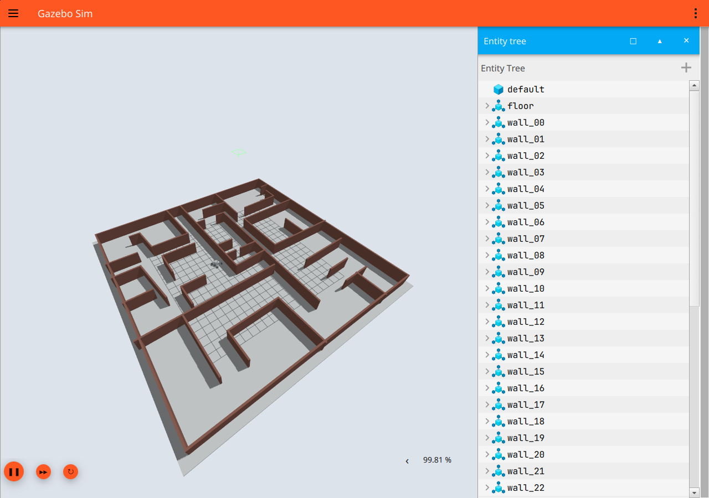
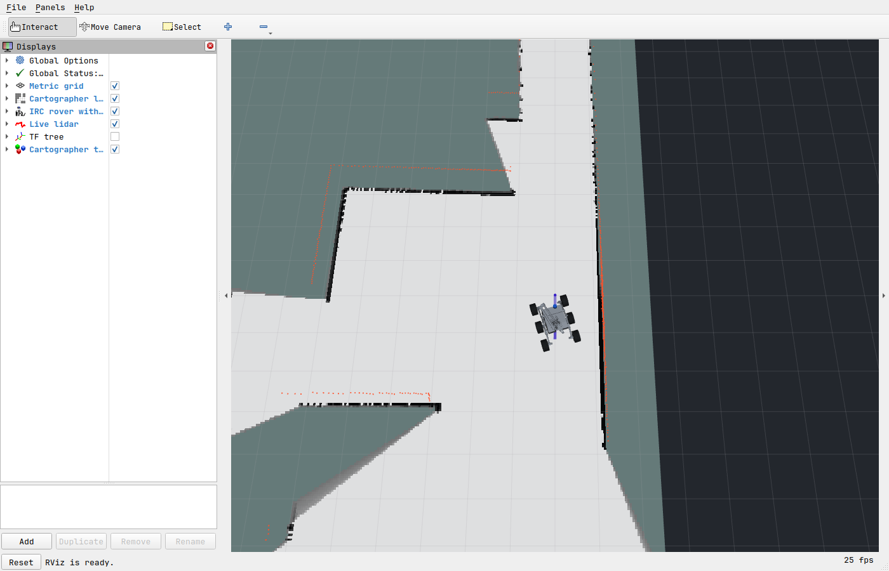

# Cartographer / DualSense validation — 2026-09-26

Runtime checks used isolated `ROS_DOMAIN_ID=78` and
`GZ_PARTITION=irc_carto_validation`, with the installed ROS 2 Jazzy and Gazebo 8.
Those variables are not required for normal use of the documented launch.

- `rosdep install --from-paths src --ignore-src -r -y`: dependencies satisfied.
- `colcon build --symlink-install`: both packages built.
- `colcon test --packages-select rover_bringup`: six tests passed, zero failures.
  Tests cover neutral startup, throttle ramp, reverse/creep/steer, stop/brake,
  input timeout/rearming, arm limits, paused-time behavior and invalid input.
- Original and arm-variant Xacro expanded successfully. `check_urdf` accepted
  the 12-link arm model with six wheel joints, two arm joints and three fixed
  joints. Gazebo SDF conversion was valid, with expected `gz_frame_id` extension
  warnings. The original rigid mesh option remains the default.
- World generator produced 42 collision walls and matching 640 x 640 synthetic
  reference occupancy raster at 0.05 m/cell. Spawn clearance check passed at
  approximately 1.127 m to the nearest wall edge.
- Gazebo spawned the articulated rover in the maze. Cartographer started
  trajectory 0 and received odometry at 50 Hz and scans at 10 Hz.
- Live `/map` was received: initially 397 x 293 cells, including 37,714 known
  cells. The measured map expanded during testing.
- Synthetic SDL-layout Joy messages were passed through the real teleop node
  and Gazebo bridges/controllers. Forward command reached 0.6 m/s, reverse
  reached -0.35 m/s, and steering produced 0.365 rad/s for the tested stick value.
- Measured arm yaw changed from approximately 0.00006 to 0.275 rad; lift changed
  from 0.00027 to 0.282 rad. Wheel odometry displacement was approximately
  1.194 m during the forward-and-release test.
- Stopping Joy publication produced exactly zero commanded drive velocity after
  the watchdog timeout. This is a command-level check, not a hardware stopping
  distance measurement.
- The connected physical DualSense was detected at device ID 0. SDL opened it
  as PS5 Controller (device name DualSense Wireless Controller); real six-axis,
  21-button Joy messages were received. End-to-end movement tests above used
  synthetic inputs; physical button-by-button calibration is not claimed.
- `save_carto_map maps/carto_maze_demo` successfully wrote a Cartographer
  `.pbstream` and occupancy `.yaml`/`.pgm` (397 x 299 at save time). This is a
  partial observed map, not full maze exploration.
- Gazebo and RViz were opened and their rendered application surfaces inspected:
  the maze/rover and live Cartographer map/scan/rover were visible. RViz emitted
  a transient shader-link warning during initial map creation; the map rendered
  successfully afterward. Screenshots are saved below.

Limitations: screenshot scale and wall tracing are approximate; no original
metric world was supplied. Arm joints/physics are an explicitly provisional
two-axis proxy; suspension remains rigid. No complete maze exploration,
hardware arm validation, hardware velocity interface, or extended-arm Nav2
footprint validation is claimed.

## Joystick troubleshooting follow-up

Real controller messages revealed an intermittent/full-left left-stick X input
while the user reported that the stick was physically centered. Linux ABS_X
also reported 0/255 while the other stick coordinates were near 128; this is
upstream of the ROS axis mapping. The former combined neutral check could block
all drive commands because of that arm-only input.

Drive and arm now use independent neutral checks. Two regression tests cover
an off-center arm input not blocking the drive, and a held throttle not blocking
neutral arm activation. All eight tests pass. The teleop node exposes live
input/arming/feedback diagnostics on `/teleop/status` and logs state transitions.
After reloading, the live node reported input_live=true, drive_armed=true and
arm_armed=false with the bad left-stick reading. Physical post-fix R2 movement
has not yet been confirmed by the user.

The current map was backed up to `maps/carto_before_joystick_fix.*` without
restarting the simulator or mapping process.
