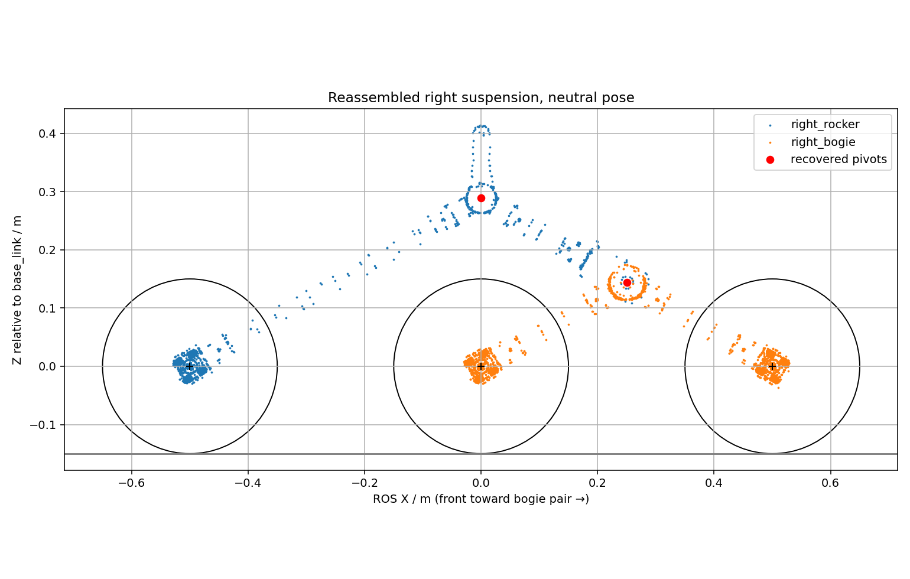

# Reverse rocker-bogie: CAD, physics and ROS 2 lessons

Update: propulsion now uses the torque-capped controller described in
[ELECTRICAL_WHEELS_BLENDER_PLAN.md](ELECTRICAL_WHEELS_BLENDER_PLAN.md), not the
historical DiffDrive setup described below. Passive suspension is unchanged;
wheel inertia now accounts for CAD honeycomb voids. Old trials are historical.

The rover now has four passive suspension joints and six driven wheel joints.
The bogie carries the front and middle wheels; the rocker carries the rear wheel.
The owner confirmed this orientation and a mechanical left/right differential.
This is an articulated, force-driven simulation, not a calibrated digital twin.

## Lesson 1 — What was recovered from the files

Sources are preserved: `INRB_suspension_load_cf_circular_right.stl` and the nine
Fusion screenshots in `Suspension mass /`. The STL contains 898,400 triangles in
42 disconnected shells, including exploded wheels and motor hardware.

Circular mesh edges identify the rocker bearing at CAD (0,0,20) mm and the bogie
holder pivot at approximately (-249.938,-144.446,20) mm. The exploded bogie ring
is at (-245.704,-117.099,18.254) mm. Reassembly translates the bogie group by
(-4.234,-27.347,+1.746) mm, making the three motor axes almost coplanar with
approximately 500 mm spacing. This is reconstructed geometry, not original CAD
mate metadata. Left-side meshes are mirrored from the supplied right assembly.



The CAD +X single-wheel end becomes ROS -X, leaving the paired bogie at the front.
The source motor hardware required an additional handedness correction: each
fixed motor/output flange now extends outboard toward its wheel instead of
pointing inboard away from it.
The existing centered tire meshes are reused at the reconstructed wheel axes;
the exploded tire positions are not used. Nominal wheel collision radius remains
0.150 m and track 0.815 m. Rocker lateral mounting at ±0.300 m is an integration
estimate; a one-sided STL cannot independently specify chassis mounting width.

Masses read from the Fusion property screenshots:

| Component | Mass (kg) | Assignment |
| --- | ---: | --- |
| Rocker joint casting | 0.291695 | Rocker |
| Rocker tube | 0.205123 | Rocker |
| Bogie holder | 0.313882 | Rocker |
| Bogie joint casting | 0.317213 | Bogie |
| Bogie tube, each | 0.090510 | Bogie, two per side |
| Motor mount, each | 0.238941 | Corresponding rocker/bogie |
| Motor, each | 0.190443 | Corresponding rocker/bogie |
| Coupler, each | 0.054917 | Rotating wheel mass |
| Wheel, each | 3.694552 | Rotating wheel mass |

Each rocker link totals 1.240084 kg, each bogie link 1.357001 kg, and each wheel
plus coupler 3.749469 kg. Motor internals are lumped into the support-link mass;
rotor inertia is not separately modeled. Small coupler visuals are omitted.
The IRC 2026-compliant mobile-base target is now **57 kg without the arm**. Xacro deducts
the six wheel/coupler masses, suspension-link masses and 0.35 kg of virtual
sensors from that total to derive `base_link` mass, so every component is counted
exactly once. The provisional arm adds 8 kg, producing a 65 kg articulated model.

The screenshots' inertia sections are collapsed. Consequently each component's
equivalent bounding box supplies an estimated COM/inertia, then the parallel-axis
theorem combines components per link. These are physically valid positive
tensors, not claimed CAD inertia tensors. Supply expanded COM/inertia properties
and a measured chassis mass to calibrate them.

## Lesson 2 — How the suspension moves

```text
base_link
├── left_rocker_joint (passive) → left_rocker_link
│   ├── rear_left_wheel_joint (driven)
│   └── left_bogie_joint (passive) → left_bogie_link
│       ├── front_left_wheel_joint (driven)
│       └── middle_left_wheel_joint (driven)
└── right_rocker_joint → matching right-side chain
```

All suspension axes use +Y. Each bogie pivots freely with small joint damping
and friction; it is not servoed to zero. The two rocker joints are coupled at
the 1 ms physics timestep by the native Gazebo `rover_simulation::Differential`
system. With angles relative to the chassis, the ideal relation is:

`q_left + q_right = 0`

The implemented approximation applies the **same generalized torque** to both
joints, based on `-k*(q_left+q_right) - d*(velocity_left+velocity_right)`, with
saturation. Opposite rocker motion is free; the common-angle error is resisted.
This models a compliant differential, rather than two springs fixing each rocker
to the chassis. Gravity and terrain contact determine articulation. It neither
teleports links nor overwrites suspension positions/velocities.

Defaults in `src/rover_description/config/suspension.yaml`:

- Differential stiffness: 1500 N·m/rad; damping: 60 N·m·s/rad; torque cap: 200 N·m.
- Rocker travel: ±0.60 rad; bogie travel: ±0.75 rad.
- Passive joint damping: 0.4 N·m·s/rad; friction: 0.02 N·m.

These are stable test parameters, **not measurements of your differential or
mechanical stops**. The gear/linkage solids and backlash are not reconstructed.
Tube collisions use simple cylinders, tires use cylinders, and chassis/arm use
simple collision envelopes. Self-collision is disabled by the model default;
this does not validate linkage/chassis clearance at extreme travel. Tire friction
remains an estimated 0.8. No tire deformation, soil sinkage, motor electrical
model, or measured torque-speed curve is included.

The Gazebo implementation uses the documented
[joint force interface](https://gazebosim.org/api/sim/8/jointforcecmdcomponent.html).
`DiffDrive` continues to drive six wheels; it is separate from the suspension
differential. On hardware, suspension remains mechanically passive.

## Lesson 3 — Workspace and files

- `rover_description`: Xacro, meshes, mass/inertia and collision configuration.
  `urdf/suspension.xacro` creates passive links/joints and the differential plugin.
  `rover.urdf.xacro` selects suspension versus rigid wheels and subtracts allocated
  masses. `gazebo.xacro` handles wheel drive, sensors and odometry. The generated
  `rover.urdf` and `rover_arm.urdf` are updated non-simulation descriptions.
- `scripts/inspect_suspension.py`: identifies STL connected shells and writes
  `docs/suspension_shells.json`, labels and a diagnostic plot.
  `scripts/prepare_suspension.py`: reassembles groups, mirrors the left side,
  estimates inertias and writes `config/suspension.yaml`, four suspension meshes,
  two derived chassis meshes and `meshes/suspension_report.json`.
  The chassis derivatives remove the old fixed suspension envelope to avoid
  doubled visuals; this spatial cut is not a semantic CAD body export.
- `rover_simulation`: new `ament_cmake` C++ package. `src/differential.cpp` is the
  physics plugin; `differential_law.hpp` contains its torque law;
  `test/test_differential.cpp` checks symmetry, limits and dissipative damping.
  `CMakeLists.txt` builds/installs `librover_differential.so`; `package.xml`
  declares Gazebo vendor dependencies. `sim.launch.py` sets the plugin path.
- `rover_bringup`: existing controller/mapping package. Its launch now exposes
  `suspension` and `terrain_lane`. `test/test_suspension.py` validates the tree,
  inertia tensors, mass accounting and unique TF publisher.
  `scripts/validate_suspension.py` records explicit simulation-only trials;
  `--drive` authorizes synthetic R2 input and always sends a stop.
  `config/terrain_gui.config` starts the Gazebo camera over the terrain course.

## Lesson 4 — Build and run

```bash
cd /home/inian/ROS2/URDF_IRC
source /opt/ros/jazzy/setup.bash
rosdep install --from-paths src --ignore-src -r -y
colcon build --symlink-install --packages-up-to rover_description rover_bringup
source install/setup.bash
python3 -m pytest src/rover_bringup/test -q
colcon test --packages-select rover_simulation
colcon test-result --verbose
ros2 launch rover_bringup carto_gamepad.launch.py terrain:=true gpu:=nvidia
```

`rosdep` resolves the package manifests; `colcon` builds the plugin before the
description package; sourcing the overlay exposes both packages and the library.
No global GPU settings are changed. To start at the staggered wheel obstacles:

```bash
ros2 launch rover_bringup carto_gamepad.launch.py \
  terrain:=true terrain_lane:=articulation gpu:=nvidia
```

Run only one stack at a time. Ctrl+C closes the launch. Gazebo is now executed
directly instead of behind a shell, so shutdown signals reach its process.
Each main launch still has an isolated Gazebo transport partition. `suspension:=false`
restores the rigid baseline; `gui:=false rviz:=false` runs headless tests.

Mesh reconstruction is reproducible, but not required for normal launches:

```bash
python3 src/rover_description/scripts/inspect_suspension.py
python3 src/rover_description/scripts/prepare_suspension.py
```

These commands regenerate `suspension.yaml`, so preserve manual calibration
changes before regenerating. Generated files are installed by the normal build.

## Lesson 5 — ROS graph and verification

The DualSense driver publishes `/joy`. `gamepad_teleop` produces `/cmd_vel` plus
`/arm/yaw/command` and `/arm/lift/command`; the bridges deliver these to Gazebo.
Right stick still drives, left stick still moves the arm, R2/L2 override throttle,
Circle stops. `/teleop/status` reports the neutral gates and input watchdog.

Gazebo publishes `/joint_states` including all four suspension joints.
`robot_state_publisher` turns the URDF plus those measured joint angles into TF.
The differential is a Gazebo system, not a ROS timer node; it needs no command
topic, service or action. Its coefficients are SDF plugin parameters, configured
through Xacro/YAML and applied on restart, not live ROS parameters.

For suspension mode, Gazebo's
[3D OdometryPublisher](https://gazebosim.org/api/sim/8/classgz_1_1sim_1_1systems_1_1OdometryPublisher.html)
provides simulation ground-truth `/odom` and `odom → base_footprint` TF, preserving
roll, pitch and elevation. The old name `base_footprint` is retained for compatibility
but is body-attached on slopes, not a continuously projected horizontal frame.
Wheel-integrated Gazebo odometry is moved to `/wheel_odom` and `/wheel_tf` and is
not bridged onto the main TF tree. This prevents two competing TF sources.

Cartographer still consumes `/scan` and `/odom`, publishes `map → odom`, and its
occupancy-grid node publishes `/map`. `/imu/data` is available but not fused by
the current 2D configuration. `/clock` drives simulation-time ROS nodes; controller
input-loss detection stays on wall time. No new ROS services/actions were added.

```bash
ros2 topic echo /joint_states
ros2 topic echo /odom --once
ros2 topic hz /scan
ros2 run tf2_ros tf2_echo odom base_link
ros2 run tf2_ros tf2_echo base_link left_bogie_link
```

In RViz, RobotModel should articulate and the chassis should pitch on ramps.
In Gazebo, inspect the moving rocker/bogie meshes and wheel-ground contact.
Check that left/right rocker angles nearly cancel. The bounded nonzero error
under load is expected from the compliant differential.

## Validation and limits

The build and dependency check pass, along with 16 Python checks and the native
differential-law test. Flat-ground and terrain measurements are recorded under
`docs/suspension_*_validation.json`. The hill/pit trial crossed about 10.3 m:
bogie angles reached approximately -0.203 to +0.207 rad (±12 degrees), chassis
height ranged -0.127 to +0.197 m relative to the flat-ground root, and maximum
rocker-sum error was 0.00394 rad (0.23 degrees). Flat-ground rocker drift over
10 simulation seconds was less than 1e-6 rad.

The offset-obstacle trial crossed 7.63 m. Left rocker angles ranged -0.0553 to
+0.0614 rad, right rocker -0.0646 to +0.0528 rad, with maximum summed-angle
error 0.00322 rad (0.19 degrees). Bogie responses differed by side, demonstrating
passive asymmetric articulation rather than identical commanded animation.

These tests establish articulation and basic numerical stability in the chosen
fixtures, not hardware fidelity, load ratings, rollover safety, or autonomous
traversability. Cartographer remains a **2D mapping demonstration**; horizontal
LiDAR does not reliably detect pits and tilted scans can distort the map.
Ground-truth odometry is convenient for physics inspection but is not a validated
real-world localization solution. Existing arm geometry/masses remain estimates.
